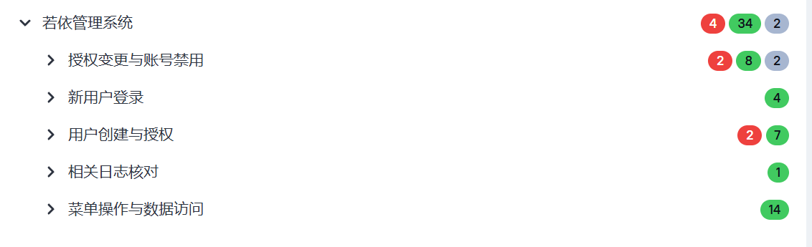
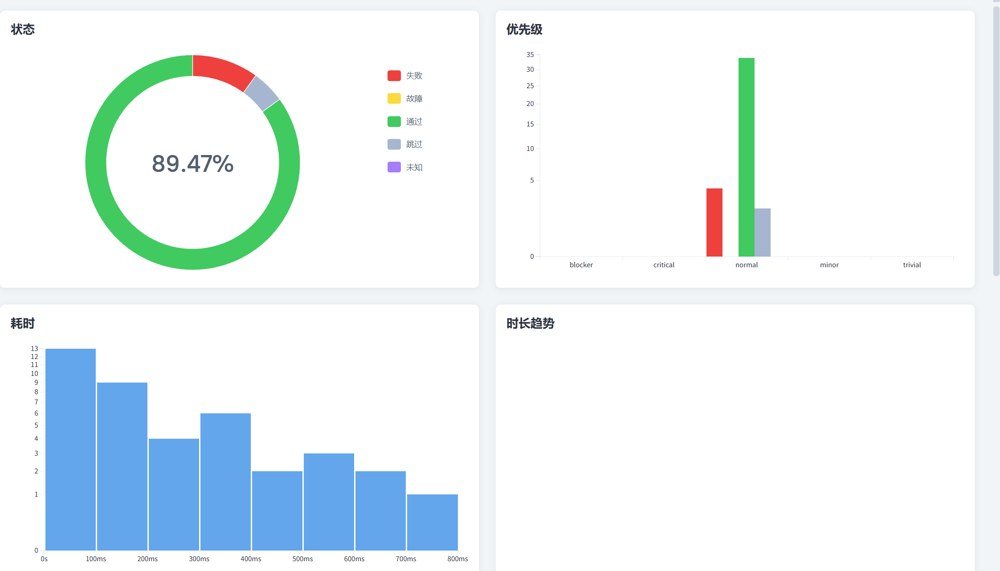

# 若依软件测试学习项目

这是我基于若依项目整理的软件测试学习作品集，记录了测试设计、执行结果、缺陷分析和阶段验收，也保留了对应的前后端源码快照。日常开发和测试在本地工作目录完成，成果整理、脱敏后再发布到这里。

作者：**x-k-forign**。最近更新：**2026-11-08｜T7接口自动化总验收**。主分支：`main`。

## 内容

- [学习大纲](若依软件测试学习大纲.md)：学习范围与验收状态。
- [T1测试计划](document_design_period1/T1_测试计划与方案.md)：需求、范围、风险与测试设计；同目录含流程图、测试用例和学习练习。
- [T2账号权限与重建验收](basic_setting_period2/T2_账号权限与重建验收.md)：环境阶段的最新验收记录；同目录含环境、启动、冒烟与截图证据。
- [主线用例设计](docs/若依主线测试用例.xlsx)：95条设计用例，保留原94条并新增T7准备中断清理用例1条。
- [功能执行计划与记录](docs/功能测试逐例执行计划与记录模板.xlsx)：五状态颜色、筛选排序，点击编号跳转实际记录；下载后使用Excel查看。
- [T3需求分析导图](functional_testing_period3/若依用户权限主线需求分析.xmind)：需求、分析方法及测试点。
- [T3缺陷报告](functional_testing_period3/T3_缺陷报告.md)与[Bug附件](functional_testing_period3/Bug附件/)：5项缺陷及独立再次复现证据。
- [T3整体验收](functional_testing_period3/docs/T3_整体验收记录.md)与[阶段文档](functional_testing_period3/docs/)：执行、抽检、验收和风险边界。
- [T6整体验收](linux_testing_period6/docs/T6_整体验收记录.md)与[排查恢复记录](linux_testing_period6/docs/T6.5_排查与恢复记录.md)：Linux练习、若依跨层调查及证据索引。
- [T7执行结果](#t7执行结果)与[接口自动化框架](api_automation_period7/)：40条正式YAML、权限与会话回归、Allure及失败证据。
- [共通用例台账](docs/)：95条设计用例、功能执行记录和跨阶段接口执行情况。

## 阶段状态

我在2026-10-09建立了这个成果仓库。截至2026-11-08，项目已完成T1—T7必需内容的阶段验收。T3围绕功能用例、权限、数据范围、新旧会话和日志展开测试，记录缺陷复现及可逆配置回归；T4补充了业务链接口测试、异常与权限验证、断言和脱敏集合复现；T5进一步核对数据库结构、查询、关联和事务，并在隔离环境中验证故障回滚，完成两轮数据准备、核验和清理；T6完成Linux文件与日志操作、进程端口检查、可逆连接故障排查，以及若依业务问题的跨层调查。T7完成YAML接口自动化框架、正式40条回归、失败清理和Allure脱敏取证。

## T3执行结果

以下保留2026-10-12的T3阶段验收结果；T4及T5后续补证状态见下文，最新为85通过、5失败、4待观察、0未执行。

| 状态 | 数量 |
|---|---:|
| 通过 | 77 |
| 失败 | 5 |
| 待观察 | 4 |
| 阻塞 | 0 |
| 未执行 | 8 |
| **合计** | **94** |

当时86条用例已有执行记录，另外8条安排在T4/T5继续验证，包括权限、非法编号请求和隔离故障注入。重复复现不增加用例总数。该批已判定用例的通过率为77/(77+5)=93.90%，仅用于记录测试结果，不作为上线依据。

5项缺陷仍未修复：黑名单无法清空、密码长度跨入口不一致、撤权后旧会话仍可新增、调部门后旧会话仍能查询原部门、权限拒绝在已核验操作日志链路中缺少审计记录。五项问题均已独立再次复现，其中部分预期依据本学习项目约定的规则，上游尚未确认。在没有修复版本的情况下，项目通过可逆配置变更练习回归测试，原缺陷仍保留未修复状态。

### 抽检方法

从执行Excel按状态筛选，点击用例编号，核对账号、时间、层次及证据位置。复现前按记录重建条件：部分样本已逻辑删除，配置已恢复。新执行另记批次，不覆盖首次结果；日志SUCCESS不能单独代表业务成功。

### T3保留范围

```text
functional_testing_period3/
├── Bug附件/
├── docs/
├── evidence_t3/
├── evidence_t3_1/
├── T3_缺陷报告.md
├── T3逐例执行计划与记录模板.xlsx
├── 若依用户权限主线需求分析.xmind
└── 若依主线测试用例_T3优化版.xlsx
```

## T4执行结果

2026-10-14，T4.1—T4.6必需内容完成整体验收。接口文档覆盖20个主线接口，当前Postman集合包含74个请求，已适配本机Postman 9.12.2。

| 状态 | 数量 |
|---|---:|
| 通过 | 24 |
| 失败 | 2 |
| 待观察 | 0 |
| 阻塞 | 0 |
| 未执行 | 3 |
| **合计** | **29** |

以上是T4累计业务用例统计，请求数和断言数另计：

- **正常业务链：** T4.4两批完整执行，各23次请求、81条断言通过，覆盖创建、部门角色关联、新用户登录、访问和清理。
- **异常与权限：** T4.5执行25条唯一用例，23通过、2失败；5位及21位密码被新增接口接受，关联未修复的BUG-T3-002。
- **断言与复现：** T4.6重新导入后的正常链为23次请求、104条断言通过；故意错误断言失败、恢复后通过。104为执行次数，含分页重复，对应28种断言名称。
- **桌面兼容：** 使用Postman 9.12.2所附Runtime 7.29.0、Sandbox 4.0.6补证正常链，23次真实请求、104条断言通过。
- **T3后续补证：** 五条权限及非法关联移交用例已通过。截至T4验收时，T3原执行表为82通过、5失败、4待观察、3未执行，共94条；上述T3阶段历史结果保留。

T4验收时三条未执行用例为TC-C08-01、TC-M07-02、TC-G04-03；现已在T5隔离故障、事务及日志专项补证通过，T4历史表不追改。既有缺陷保持未修复。

### T4成果入口

- [T4整体验收记录](api_testing_period4/docs/T4_整体验收记录.md)
- [若依接口文档](api_testing_period4/若依接口文档.md)
- [T4接口用例执行记录](api_testing_period4/T4接口用例执行记录.xlsx)
- [104条断言说明](api_testing_period4/T4.6_104条断言说明.md)
- [Postman验收交付集合](api_testing_period4/postman/T4_验收交付.postman_collection.json)与[空环境模板](api_testing_period4/postman/T4_验收交付_空环境.postman_environment.json)
- [桌面端使用说明](api_testing_period4/docs/T4阶段_桌面端使用说明.md)与[执行证据](api_testing_period4/evidence_t4/)


## T5执行结果

2026-10-28，项目完成T5.1—T5.6，并通过10项总验收标准。这一阶段采用自动化执行，我结合SQL、接口结果和执行记录理解查询、关联与事务的行为，核对测试结论。T6的后续成果见下文。

| 阶段 | 核心成果 |
|---|---|
| T5.1 | 核心9表86字段、实际结构/关系及权限核对 |
| T5.2 | 9组查询对照；32次CLI请求、217次断言通过 |
| T5.3 | 独立练习表、双连接事务；68步、41项检查通过 |
| T5.4 | 用户/角色/部门/岗位/菜单关联；12次请求、63次断言通过 |
| T5.5 | 三条遗留用例隔离真实异常与回滚通过，日志关联、源码恢复和正常对照完成 |
| T5.6 | 同SQL/集合两轮准备、核验、清理；每轮5次CLI请求、21次断言通过 |

**当前T3合计94条：85通过、5失败、4待观察、0阻塞、0未执行。** TC-C08-01、TC-M07-02、TC-G04-03已在原执行表追加T5批次；历史77/5/4/8及82/5/4/3保留。T4仍按历史29条（24通过、2失败、3未执行）展示。

BUG-T3-001—005仍未修复，T5.5再次复现了003/004。阶段验收确认的是既定学习与测试任务已完成，产品缺陷仍按原状态记录。T5.6结束后，隔离服务已停止，测试库、基线测试数据、逻辑删除记录和审计记录按恢复方案保留；再次运行前需要检查环境状态。

- [T5总验收依据](database_testing_period5/evidence/T5_ACCEPT_20261028/overall_validation.json)
- [T5阶段说明](database_testing_period5/docs/)与[脱敏执行证据](database_testing_period5/evidence/)
- [SQL交付](database_testing_period5/sql/)与[Postman集合](database_testing_period5/postman/)
- [T5.6两轮流程说明](database_testing_period5/docs/T5.6_执行说明.md)：prepare.sql、verify.sql、cleanup.sql是流程中的只读检查，业务创建/删除由API完成，三份SQL不能单独完成整条业务链。
- [隔离与恢复方案](sources/independence_enviroment/隔离与恢复方案.md)

## T6执行结果

2026-11-02，项目完成T6.1—T6.5，并通过8项整体标准。内容包括Linux环境与文件权限核对、真实日志副本检索、进程和端口检查、可逆连接故障排查，以及若依接口、应用日志、操作审计和数据库结果的关联分析。

| 阶段 | 核心成果 |
|---|---|
| T6.1 | 核对Windows与Ubuntu运行边界，准备真实脱敏日志副本和独立回环HTTP服务 |
| T6.2 | 完成文件定位、权限查看、上下文检索和完整事件提取，区分grep匹配、无匹配与读取错误 |
| T6.3 | 完成错误端口的失败复现、分层排查、针对性处理、原请求复验和相关最小回归 |
| T6.4 | 在既有隔离环境中再次复现BUG-T3-004，关联新旧会话请求、实际SQL过滤、独立SQL和操作审计 |
| T6.5 | 整理两类案例的排查过程与证据索引，核对恢复范围，保留失败尝试和未证实的定位线索 |

两个案例的结果分别记录：Linux练习服务在纠正客户端端口后恢复；若依调部门问题仍未修复。受测用户109的部门已从200保存为201，旧会话却继续返回原部门用户110，运行SQL仍过滤部门200；新会话返回109、111，SQL采用部门201。Postman CLI本轮3次请求、22次断言执行，18通过、4失败，退出码1。四个失败均来自旧会话的数据范围检查，已完整保留。

本次复现关联原BUG-T3-004，不新增重复缺陷编号或业务用例。T3仍为94条：85通过、5失败、4待观察，原5项缺陷均未关闭。阶段验收确认的是既定测试任务和成果，不能据此判定产品可上线。

若依后端继续运行在Windows，Ubuntu用于Redis和Linux练习。Linux中的若依日志是带来源记录的脱敏副本；进程和连接排查使用独立服务。记录中分别标明了实际执行时间、运行位置、正常对照、清理范围和结论限制。

- [T6整体验收记录](linux_testing_period6/docs/T6_整体验收记录.md)与[验收依据](linux_testing_period6/evidence/T6_ACCEPT_20261102/overall_validation.json)
- [连接故障排查](linux_testing_period6/docs/T6.3_执行记录.md)与[若依跨层调查](linux_testing_period6/docs/T6.4_执行记录.md)
- [排查与恢复记录](linux_testing_period6/docs/T6.5_排查与恢复记录.md)及[脱敏证据](linux_testing_period6/evidence/)
- [新旧会话范围核验集合](linux_testing_period6/postman/T6.4_新旧会话范围核验.postman_collection.json)与[只读复查SQL](linux_testing_period6/sql/T6.4_只读核查.sql)

测试账号已按批次清理，历史ID用于核对原记录，不能直接作为新的登录账号。复现前需检查环境、准备新批次对象和私有凭据；日志中的SUCCESS、HTTP200或CLI退出码都不能单独替代业务判定。

### 发布范围

我在仓库中保留阶段说明、可复用SQL、脱敏请求集合，以及支撑结论的接口、SQL、日志、清理和验收证据。`backups/`、`execution_build/`、`.local/`、`.private/`、依赖、JAR、隔离源码副本和运行时配置留在本地，不上传。本次也排除了未被成果引用的重复快照和一次性调试输出；独立HTTP练习所需的诊断小工具随对应证据保留。

历史证据中的本地路径和脚本、构建摘要用于追踪当次执行，部分引用对应的过程文件并未发布。T5/T6当时的完整过程运行器保留在本地；T7请求封装、YAML执行器及用例随本次发布。复现仍需自行准备若依服务、Python环境和私有配置。

## T7执行结果

本节更新于2026-11-08。T7内部阶段文档保留在本地，下面的说明、源码、YAML及脱敏证据用于公开查阅。

这一阶段沿用前面整理的五条业务主线，把适合重复回归的接口检查写成YAML，用Python、Requests和pytest统一执行。主要检查用户创建与授权、新用户登录、操作权限、部门数据范围、授权变更、账号禁用和登录日志。

当前共有40条正式自动化用例，执行结果为34通过、4失败、2条已执行待确认。T7必需阶段已完成总验收，产品缺陷和未决规则继续保留。这里整理框架的组成、用例结果和运行方法。

### 框架依赖

#### 环境与主要依赖

项目使用Python 3.13.12，依赖安装在本项目的`.venv`中。运行环境为Windows和PowerShell，若依后端地址为`http://127.0.0.1:8080`。

| 依赖或工具 | 当前版本 | 用途 |
| --- | --- | --- |
| Python | 3.13.12 | 编写请求、断言、变量处理和收尾代码 |
| Requests | 2.34.2 | 发送HTTP请求，管理独立Session，设置连接和读取超时 |
| pytest | 9.2.0 | 收集执行用例，通过fixture管理前置与清理，记录断言结果 |
| PyYAML | 6.0.3 | 读取YAML用例和配置 |
| jsonpath | 0.82.2 | 从JSON响应中提取字段，供后续步骤使用 |
| responses-validator | 0.3.0 | 辅助检查HTTP状态、响应头和正文 |
| lxml | 6.1.3 | 提供XPath解析能力 |
| redis | 5.3.1 | 从测试Redis只读本次uuid对应的验证码答案 |
| allure-pytest | 2.16.2 | 将pytest结果、分组、步骤和附件写入Allure原始结果 |
| pytest-result-log | 1.2.2 | 在日志中补充用例执行结果和分隔信息 |
| Allure命令行 | 2.46.1 | 将原始结果转换成网页报告，需要本机可用的Java环境 |

`allure-pytest`负责写结果，Allure命令行负责生成和打开网页，两者都需要准备。当前环境还保留了pytest-html、pytest-rerunfailures、pytest-xdist等练习依赖；本项目的报告使用Allure，正式业务套件按串行执行，不自动重跑失败用例。

#### 安装与配置

`requirements.txt`列出项目直接使用的依赖，`requirements.lock.txt`保存当前环境的固定版本。重新准备环境时，先创建虚拟环境，再用该环境的解释器安装依赖。

安装Python 3.13后，在仓库根目录打开PowerShell，再进入接口自动化目录：

```powershell
Set-Location .\api_automation_period7

# 首次准备环境时创建；已有.venv时跳过这条
python -m venv .venv

# 使用项目解释器安装固定版本，并检查依赖
.\.venv\Scripts\python.exe -m pip install -r .\requirements.lock.txt
.\.venv\Scripts\python.exe -m pip check
```

环境配置默认读取`.private/t74.local.json`，也可以用`--api-config`指定本地JSON或YAML文件。[JSON配置示例](api_automation_period7/data/config/environment.example.json)和[YAML配置示例](api_automation_period7/data/config/environment.example.yaml)放在`data/config`，真实账号密码和Redis连接信息只保存在本地私有配置中。首次使用可复制完整YAML模板到`.private/t74.local.yaml`，填写本人测试环境参数，并在运行命令中加`--api-config .private/t74.local.yaml`；该文件不上传。

后端和测试Redis需要提前启动。验证码保持开启：先请求验证码接口取得本次uuid，再读取对应答案，填写同次code/uuid，最后提交正常登录校验。需要手动输入时，可显式选择`--captcha-mode manual`。

### 文件夹的作用

#### 目录说明

| 目录 | 作用 |
| --- | --- |
| `commons` | 公共封装，包括请求、响应断言、变量替换与提取、验证码、账号准备、权限检查、资源清理和脱敏取证 |
| `tests` | 正式业务YAML和统一执行器，按五条业务主线及功能子目录管理 |
| `tests/断言失败副本测试` | 正式40条的镜像副本，保留两处故意错误的HTTP断言，用于验证断言和失败清理 |
| `data/config` | 不含真实密码的环境配置示例 |
| `data/scenarios` | 场景数据和输入约定，例如5、6、20、21位密码边界 |
| `data/templates` | 创建用户等操作使用的数据模板 |
| `data/temps` | 当前Allure原始结果、逐例HTTP摘要、运行结果和失败索引；下一次实际执行会覆盖 |
| 仓库根目录`docs` | 跨阶段共用的设计用例、功能执行和接口执行工作簿 |
| 仓库根目录`images/t7` | 本节使用的两张报告截图 |
| `evidence` | 共通台账及阶段验收需要引用的脱敏证据 |
| `logs` | pytest运行日志，便于查找执行步骤与失败信息 |
| `report` | 当前Allure网页，以及报告中关联的证据文件 |
| `outputs` | 导出的工作簿副本；正式用例状态以若依项目共通docs中的台账为准 |
| `.private` | 真实环境配置、本地资源台账等私有文件 |
| `.local` | 本地核查脚本和临时文件，不进入正式业务用例收集 |
| `.venv` | 本项目的Python解释器和第三方依赖 |
| `.pytest_cache` | pytest生成的缓存，可在需要时重新生成 |
| `.idea`、`.vscode` | 编辑器的本地项目设置 |

原始结果统一放在`data/temps`，网页报告保留在根目录`report`。项目不再自动创建`reports`历史归档。

#### 关键文件

| 文件 | 作用 |
| --- | --- |
| `main.py` | 总调度入口，负责参数处理、筛选用例、启动pytest、生成Allure和返回真实退出码 |
| `tests/test_yaml_case.py` | 接收收集到的YAML，逐条执行用例 |
| `conftest.py` | 提供公共fixture，并通过pytest钩子注册命令选项、收集YAML、添加标记和记录执行阶段 |
| `pytest.ini` | 设置收集入口、mark、Allure原始结果路径和日志格式 |
| `data/case_mapping.yaml` | 记录YAML与原TC编号、辅助前置和已知缺陷的对应关系 |
| `data/assertion_copy_mapping.yaml` | 记录教学副本与正式YAML的对应关系 |
| `requirements.txt`、`requirements.lock.txt` | 记录直接依赖和固定版本 |
| 仓库根目录`README.md` | 项目首页，T7说明集中在本节 |

### 框架执行流程

运行`main.py`后，pytest按所选分组或标记收集YAML，公共fixture为每条用例准备独立的上下文、身份和数据。`test_yaml_case.py`调用执行器，按YAML顺序发送请求、断言响应、提取变量。执行结束后完成本例收尾，再将真实结果和脱敏证据交给Allure生成报告。

#### YAML用例格式

用例保持`name / mark / steps`的写法。`request`发送请求，`response`核对结果，`extract`将响应字段保存为变量。下面是已有“未登录查询身份”用例使用的格式：

```yaml
name: 未登录时拒绝查询用户身份
mark: [user_access]
steps:
  - request:
      method: GET
      url: "${base_url}/getInfo"
      params: {}
  - response:
      status_code: 200
      json:
        code: 401
      absent: [user, token]
  - extract:
      rejected_code: [json, "$.code"]
```

这里HTTP状态为200，业务码为401。用例预期就是拒绝未登录访问，因此断言符合时应判通过。HTTP200和业务成功需要分别判断。

#### 前置、数据关联与清理

`case_context`保存本条用例的变量、当前响应、独立会话、已创建资源和收尾状态。新用户ID、Token及部门角色关联都从本次请求或查询中取得，后续步骤通过变量引用，不使用历史运行留下的ID或凭证。

公共fixture只准备辅助条件，被测动作仍留在YAML中。例如新用户登录用例可以由fixture先准备账号，但登录、身份核对和退出由该用例自己执行。创建授权与新用户登录分别准备数据，单独运行也能完成。

收尾在业务准备前登记。正常结束、断言失败或准备中途失败，都按本例台账核对归属、恢复变更、删除回查，再退出会话并检查旧Token失效。清理失败保留为teardown错误，原来的业务失败也继续保留。

### 执行用例情况

#### 框架用例执行情况

本阶段形成40条正式自动化执行用例，另有40份断言失败副本，默认运行只收集正式集合。业务设计新增1条“创建用户后准备中断，账号和原会话仍能清理”，编号为`TC-T75-CLEAN-01`；其余执行单元承接已有业务和认证检查，并按当前框架拆分、组织。

40条YAML关联41个TC编号。用例、TC、HTTP请求和pytest阶段事件分别统计；副本不新增业务TC，查询授权基础资料也不单独冒充一条原业务用例。

以下结果取自2026-11-08 22:06:37～22:07:56（Asia/Shanghai）的正式运行：

| 业务主线 | 正式用例 | 通过 | 失败 | 已执行待确认 |
| --- | ---: | ---: | ---: | ---: |
| 用户创建与授权 | 9 | 7 | 2 | 0 |
| 新用户登录 | 4 | 4 | 0 | 0 |
| 菜单操作与数据访问 | 14 | 14 | 0 | 0 |
| 授权变更与账号禁用 | 12 | 8 | 2 | 2 |
| 相关日志核对 | 1 | 1 | 0 | 0 |
| 合计 | 40 | 34 | 4 | 2 |

| TC编号 | 执行用例 | 分组 | 状态 |
| --- | --- | --- | --- |
| TC-C02-01 | [登录名为空时拒绝创建，且本批无新增账号](api_automation_period7/tests/用户创建与授权/创建参数校验/01_登录名为空.yaml) | 用户创建与授权 / 创建参数校验 | 通过 |
| TC-C03-01 | [重复登录名被拒绝，原账号及授权保持不变](api_automation_period7/tests/用户创建与授权/创建参数校验/02_登录名重复.yaml) | 用户创建与授权 / 创建参数校验 | 通过 |
| TC-C09-01 | [创建密码5位：应拒绝且不产生账号](api_automation_period7/tests/用户创建与授权/创建密码边界/01_密码5位.yaml) | 用户创建与授权 / 创建密码边界 | 失败 |
| TC-C09-02 | [创建密码6位：允许创建且关联正确](api_automation_period7/tests/用户创建与授权/创建密码边界/02_密码6位.yaml) | 用户创建与授权 / 创建密码边界 | 通过 |
| TC-C09-05 | [创建密码20位：允许创建且关联正确](api_automation_period7/tests/用户创建与授权/创建密码边界/03_密码20位.yaml) | 用户创建与授权 / 创建密码边界 | 通过 |
| TC-C09-06 | [创建密码21位：应拒绝且不产生账号](api_automation_period7/tests/用户创建与授权/创建密码边界/04_密码21位.yaml) | 用户创建与授权 / 创建密码边界 | 失败 |
| TC-C01-01 | [创建用户成功，部门角色与岗位关联保存一致](api_automation_period7/tests/用户创建与授权/创建授权/01_创建授权.yaml) | 用户创建与授权 / 创建授权 | 通过 |
| TC-T75-CLEAN-01 | [创建用户后准备中断，账号和原会话仍能清理](api_automation_period7/tests/用户创建与授权/创建授权/02_创建后准备中断并清理.yaml) | 用户创建与授权 / 创建授权 | 通过 |
| 前置资料检查 | [管理员能够查询配置中的部门和角色](api_automation_period7/tests/用户创建与授权/授权基础资料查询/01_查询配置部门和角色.yaml) | 用户创建与授权 / 授权基础资料查询 | 通过 |
| TC-T4-AUTH-01 | [未登录时拒绝查询用户身份](api_automation_period7/tests/新用户登录/未登录访问控制/01_未登录查询身份.yaml) | 新用户登录 / 未登录访问控制 | 通过 |
| TC-L01-01 | [新建用户登录身份正确，获准访问且退出后原令牌失效](api_automation_period7/tests/新用户登录/登录与退出/01_新用户登录与退出.yaml) | 新用户登录 / 登录与退出 | 通过 |
| TC-T4-AUTH-03 | [管理员登录后能查询身份，退出后原Token失效](api_automation_period7/tests/新用户登录/登录与退出/02_管理员登录与退出.yaml) | 新用户登录 / 登录与退出 | 通过 |
| TC-L03-02、TC-L12-01 | [密码错误不获得新身份，受保护接口继续拒绝访问](api_automation_period7/tests/新用户登录/登录异常/01_错误密码与失败后访问.yaml) | 新用户登录 / 登录异常 | 通过 |
| TC-C05-01 | [已登录的查询用户无新增权限，拒绝后不产生账号](api_automation_period7/tests/菜单操作与数据访问/功能操作权限/01_无新增权限.yaml) | 菜单操作与数据访问 / 功能操作权限 | 通过 |
| TC-A02-01 | [同部门权限对照：查询用户拒绝新增，维护用户新增成功](api_automation_period7/tests/菜单操作与数据访问/功能操作权限/02_同部门不同角色新增对照.yaml) | 菜单操作与数据访问 / 功能操作权限 | 通过 |
| TC-A11-01 | [多角色均有效时范围合并正确，新增按授权部门获准](api_automation_period7/tests/菜单操作与数据访问/多角色权限/01_有效角色范围并集.yaml) | 菜单操作与数据访问 / 多角色权限 | 通过 |
| TC-A11-02 | [附加角色停用后新登录仅保留有效角色范围与查询权限](api_automation_period7/tests/菜单操作与数据访问/多角色权限/02_停用角色后新会话.yaml) | 菜单操作与数据访问 / 多角色权限 | 通过 |
| TC-A04-01 | [管理员可以通过动态用户ID查询本人资料](api_automation_period7/tests/菜单操作与数据访问/用户详情查询/01_管理员查询本人资料.yaml) | 菜单操作与数据访问 / 用户详情查询 | 通过 |
| TC-A04-01 | [普通查询用户读取获准目标，资料与角色岗位关联正确](api_automation_period7/tests/菜单操作与数据访问/用户详情查询/02_普通用户查询获准资料.yaml) | 菜单操作与数据访问 / 用户详情查询 | 通过 |
| TC-A05-01 | [部门A普通用户完整查询仅返回本部门记录](api_automation_period7/tests/菜单操作与数据访问/部门数据范围/01_本部门A.yaml) | 菜单操作与数据访问 / 部门数据范围 | 通过 |
| TC-A05-02 | [部门B普通用户完整查询仅返回本部门记录](api_automation_period7/tests/菜单操作与数据访问/部门数据范围/02_本部门B.yaml) | 菜单操作与数据访问 / 部门数据范围 | 通过 |
| TC-A06-01 | [本部门及以下范围包含本部门和下级部门完整记录](api_automation_period7/tests/菜单操作与数据访问/部门数据范围/03_本部门及下级.yaml) | 菜单操作与数据访问 / 部门数据范围 | 通过 |
| TC-A07-01 | [仅本人数据范围只返回当前用户自身](api_automation_period7/tests/菜单操作与数据访问/部门数据范围/04_仅本人.yaml) | 菜单操作与数据访问 / 部门数据范围 | 通过 |
| TC-A08-01 | [自定义数据范围只返回明确授权的部门](api_automation_period7/tests/菜单操作与数据访问/部门数据范围/05_自定义部门.yaml) | 菜单操作与数据访问 / 部门数据范围 | 通过 |
| TC-A09-01 | [全部数据范围与管理员当前完整ID基准一致](api_automation_period7/tests/菜单操作与数据访问/部门数据范围/06_全部数据.yaml) | 菜单操作与数据访问 / 部门数据范围 | 通过 |
| TC-A10-01 | [有列表权限但无匹配账号时正常返回空列表](api_automation_period7/tests/菜单操作与数据访问/部门数据范围/07_无匹配记录.yaml) | 菜单操作与数据访问 / 部门数据范围 | 通过 |
| TC-A10-02 | [范围外真实存在的目标账号不向普通用户泄漏](api_automation_period7/tests/菜单操作与数据访问/部门数据范围/08_范围外目标.yaml) | 菜单操作与数据访问 / 部门数据范围 | 通过 |
| TC-M09-01 | [增加有效新增角色后，新登录获准新增且原查询权限仍可用](api_automation_period7/tests/授权变更与账号禁用/增授与新旧会话/01_新会话获得新增授权.yaml) | 授权变更与账号禁用 / 增授与新旧会话 | 通过 |
| TC-M09-03 | [只增加无新增授权的角色，新登录仍拒绝新增且保持查询能力](api_automation_period7/tests/授权变更与账号禁用/增授与新旧会话/02_增加普通角色仍拒绝新增.yaml) | 授权变更与账号禁用 / 增授与新旧会话 | 通过 |
| TC-M09-02 | [增授后旧A实际权限与新B获准新增的真实对照](api_automation_period7/tests/授权变更与账号禁用/增授与新旧会话/03_增授后旧会话观察.yaml) | 授权变更与账号禁用 / 增授与新旧会话 | 已执行待确认 |
| TC-M01-01、TC-M03-01 | [撤销新增角色后，新登录会话按新权限拒绝新增](api_automation_period7/tests/授权变更与账号禁用/撤权后新会话/01_撤权后拒绝新增.yaml) | 授权变更与账号禁用 / 撤权后新会话 | 通过 |
| TC-M02-01 | [撤权即时生效：旧A与新B均应拒绝新增且无非法写入](api_automation_period7/tests/授权变更与账号禁用/撤权后旧会话/01_撤权后旧会话与新会话对照.yaml) | 授权变更与账号禁用 / 撤权后旧会话 | 失败 |
| TC-M07-01 | [无修改权限用户不能改变账号状态及关联](api_automation_period7/tests/授权变更与账号禁用/操作权限校验/01_无修改权限不能改状态.yaml) | 授权变更与账号禁用 / 操作权限校验 | 通过 |
| TC-M08-01 | [正常修改角色后仍可登录，身份与新角色权限正确](api_automation_period7/tests/授权变更与账号禁用/正常变更后登录/01_角色变更后登录.yaml) | 授权变更与账号禁用 / 正常变更后登录 | 通过 |
| TC-M08-02 | [正常调整部门后仍可登录，实际身份与新部门正确](api_automation_period7/tests/授权变更与账号禁用/正常变更后登录/02_部门变更后登录.yaml) | 授权变更与账号禁用 / 正常变更后登录 | 通过 |
| TC-M04-01 | [调部门即时生效：旧A与新B均应采用新部门完整范围](api_automation_period7/tests/授权变更与账号禁用/调部门与新旧会话/01_调部门后旧会话范围.yaml) | 授权变更与账号禁用 / 调部门与新旧会话 | 失败 |
| TC-M04-02 | [调部门后新登录采用新范围，包含迁入本人且不返回原部门数据](api_automation_period7/tests/授权变更与账号禁用/调部门与新旧会话/02_调部门后新会话范围.yaml) | 授权变更与账号禁用 / 调部门与新旧会话 | 通过 |
| TC-M05-01、TC-L04-01 | [账号禁用后拒绝新登录，恢复状态可回查](api_automation_period7/tests/授权变更与账号禁用/账号禁用/01_禁用后拒绝新登录.yaml) | 授权变更与账号禁用 / 账号禁用 | 通过 |
| TC-M06-01 | [禁用后旧A访问与新B登录拒绝的真实对照](api_automation_period7/tests/授权变更与账号禁用/账号禁用/02_禁用后旧会话观察.yaml) | 授权变更与账号禁用 / 账号禁用 | 已执行待确认 |
| TC-G01-01 | [成功登录日志能关联本轮账号、时间及结果](api_automation_period7/tests/相关日志核对/登录日志/01_本轮成功登录日志.yaml) | 相关日志核对 / 登录日志 | 通过 |

下图按五条业务主线展示同一组40条正式用例：



本轮共记录2059次HTTP请求，包含前置、业务步骤及收尾。setup、call、teardown各40个，共120个阶段事件，仍对应40条用例。pytest退出码为1，Allure生成退出码为0，表示业务中仍有失败，但报告已成功生成。

#### 跳过用例说明

| 用例 | 已完成的检查 | 保留待确认的原因 |
| --- | --- | --- |
| TC-M06-01：禁用后旧会话访问 | 保留旧A访问、新B登录拒绝的实际结果和时间线，并完成清理 | 账号禁用是否应联动旧会话立即下线，规则尚未确认 |
| TC-M09-02：增授后旧会话权限 | 完成旧A与新B的权限对照，并记录写后回查和清理 | 新增授权何时对旧会话生效，规则尚未确认 |

这两条都已发送实际请求，明确预期的部分也完成了断言。报告显示Skipped，是因为最终业务规则待确认，不计为通过。

#### 失败用例说明

下表链接的是T7.8留存批次的证据，本次正式复跑中这4条的结果一致。当前运行的请求时间线和失败位置可以从`data/temps/failure_index.json`查看。

| 用例 | 预期 | 实际结果 | 关联缺陷 |
| --- | --- | --- | --- |
| [TC-C09-01：5位密码](api_automation_period7/evidence/T78_20261108_afed83d2/TC-C09-01.json) | 超出6～20位要求，应拒绝创建，业务码500 | 本次实测长度5，业务码200，账号创建成功 | BUG-T3-002 |
| [TC-C09-06：21位密码](api_automation_period7/evidence/T78_20261108_afed83d2/TC-C09-06.json) | 超出6～20位要求，应拒绝创建，业务码500 | 本次实测长度21，业务码200，账号创建成功 | BUG-T3-002 |
| [TC-M02-01：撤权后的旧会话](api_automation_period7/evidence/T78_20261108_afed83d2/TC-M02-01.json) | 保存撤权后旧A与新B均不能新增，且不产生账号 | 旧A仍能写入，新B已按新权限拒绝；管理员回查发现旧A产生账号 | BUG-T3-003 |
| [TC-M04-01：调部门后的旧会话](api_automation_period7/evidence/T78_20261108_afed83d2/TC-M04-01.json) | 旧A与新B均应使用新部门的数据范围 | 旧A仍返回原部门范围，新B使用新范围 | BUG-T3-004 |

4条失败对应3个既有缺陷，预期和缺陷状态均未调整。密码证据保留设计长度与实际发送长度，不公开密码原文；权限证据保留旧A、新B、预期与实际ID集合，以及管理员写后回查。

失败后的账号、角色、部门和会话也要收尾。本轮88个用户、34个角色、45个部门均已清理回查，79个成功会话已退出并确认原Token失效。准备中断用例和教学副本的失败清理另有实测记录。

#### 功能与接口用例情况

共通用例表统一放在若依项目的docs中。不同阶段引用同一份台账，阶段说明和验收记录留在各自项目内。

| 记录 | 当前数量与状态 | 统计范围 |
| --- | --- | --- |
| [若依主线测试用例](docs/若依主线测试用例.xlsx) | 95条设计用例，原94条加T7新增清理用例1条 | 设计清单，不代表全部已经完成接口自动化 |
| [功能测试逐例执行记录](docs/功能测试逐例执行计划与记录模板.xlsx) | 原94条：85通过、5失败、4待观察 | 功能层累计结果，沿用表中截至T5.5的补证记录 |
| [接口用例执行记录](docs/接口用例执行记录.xlsx) | 53个唯一TC：47通过、4失败、2待观察 | 跨阶段接口累计结果，重复运行不增加唯一TC数 |
| 本次正式自动化 | 40条YAML，关联41个TC编号：34通过、4失败、2已执行待确认 | 当前选定的接口回归集合，部分映射只覆盖原TC的接口检查部分 |
| 断言失败副本 | 40份镜像，包含两处故意HTTP999断言 | 教学验证，按副本模式单独执行，不计入正式40条结果 |

功能层记录与接口层记录分别保留。例如页面限制了密码长度，并不能代替后端接口对同一规则的校验。一次自动化也不代表原TC中的页面操作、日志和数据库检查都重新执行过。

### 配置与运行方式

#### 正式、单例与分组执行

以下命令都在项目根目录执行：

```powershell
# 查看正式用例清单，不发送业务请求
.\.venv\Scripts\python.exe .\main.py --business --list

# 只检查收集，不执行接口
.\.venv\Scripts\python.exe .\main.py --business --collect-only -q

# 执行全部正式40条，结束后生成Allure
.\.venv\Scripts\python.exe .\main.py --business -v
$testExit = $LASTEXITCODE
Write-Output ('test exit=' + $testExit)

# 精确执行5位密码这一实例
.\.venv\Scripts\python.exe .\main.py --business --case-id TC-C09-01_pwd05 -v

# 按主线、功能分组或标记执行
.\.venv\Scripts\python.exe .\main.py --business --group 用户创建与授权 -v
.\.venv\Scripts\python.exe .\main.py --business --group 新用户登录/登录与退出 -v
.\.venv\Scripts\python.exe .\main.py --business -m user_access -v
```

`--case-id`使用执行实例ID。四份密码边界的实例分别为`TC-C09-01_pwd05`、`TC-C09-02_pwd06`、`TC-C09-05_pwd20`和`TC-C09-06_pwd21`，仍是四份独立YAML。原TC与实例的对应关系保存在`data/case_mapping.yaml`。

#### 副本与验证码模式

```powershell
# 运行断言失败副本，结果会覆盖当前报告
.\.venv\Scripts\python.exe .\main.py --assertion-copy -v

# 显式切换为人工验证码
.\.venv\Scripts\python.exe .\main.py --business --captcha-mode manual -s -v
```

默认验证码模式为Redis自动取码，选择manual后，含登录前置或登录步骤的用例会动态添加interactive标记。两种模式都保持服务端验证码开启。

副本中两份详情查询用例将正确HTTP预期200改为999，用来确认断言确实会失败；恢复200后，两条均已实测通过。交付副本继续保留999供后续对照。去掉副本开关后，需要重新运行正式用例，报告才会恢复为正式结果。

### 测试报告

本地运行后，Allure网页生成到`api_automation_period7/report`。进入接口自动化目录后执行：

```powershell
allure open report
```

通过Allure本地服务查看报告，页面可以加载用例详情和附件。报告网页入口为`report/index.html`，原始执行结果在`data/temps`。

需要只重新生成网页、不重新测试时执行：

```powershell
.\.venv\Scripts\python.exe .\main.py --report-only
```

正式和副本共用一份data/temps与report，每次实际执行会覆盖当前结果。evidence只保留台账和验收需要引用的脱敏证据，不自动保存完整历史报告。

#### 可视化

Allure按以下层级组织业务用例：

| 层级 | 本项目对应内容 |
| --- | --- |
| epic | 若依管理系统 |
| feature | 五条业务主线 |
| story | 主线下的功能分组，如创建密码边界、登录与退出、部门数据范围 |
| title | YAML中的name，即用例标题 |

图表可以查看状态分布、优先级和执行耗时，进入单条用例还能查看步骤、失败信息及证据附件。



本次截图中的89.47%按34÷（34＋4）计算，未将2条Skipped计入分母。按全部40条正式用例计算，通过占比为85%；两条待确认仍单独保留，不能据图表百分比计为通过。

### 日志记录

#### 日志与证据位置

| 位置 | 记录内容 |
| --- | --- |
| `logs/pytest.log` | 正式运行日志，包含时间、级别、模块及行号，可检索用例和失败原因 |
| `logs/pytest_assertion_copy.log` | 副本模式运行时生成的日志 |
| `data/temps/current_run.json` | 当前集合、数量、各阶段事件、pytest退出码和Allure生成退出码 |
| `data/temps/failure_index.json` | 分别列出失败与待确认，用原TC、实例ID、nodeid和YAML路径定位 |
| `data/temps/phase_results.json` | setup、call、teardown分别发生了什么，原失败与收尾错误不会相互覆盖 |
| `data/temps/environment_info.json` | 解释器和依赖版本、目标环境、源码提交及部署版本的核实范围 |
| `data/temps/cases/<batch_tag>/http.jsonl` | 本例前置、业务和收尾请求的脱敏时间线 |
| `data/temps/cases/<batch_tag>/case_index.json` | 本例阶段、最后步骤、预期/实际和失败位置 |
| `data/temps/cases/<batch_tag>/run_summary.json` | 资源归属、变更恢复、删除回查和会话退出情况 |
| `.local/last_business_pytest.xml` | 最近一次正式运行的JUnit结果，供退出状态及错误核对；副本对应`.local/last_assertion_copy_pytest.xml` |

#### 失败排查与脱敏

查看失败时，先从Allure或failure_index找到用例，核对失败发生在准备、业务断言还是收尾，再沿同一batch_tag查看HTTP时间线和run_summary。索引附有精确单例命令，可以按相同规则重新验证。

请求返回后、复杂断言前先保存安全摘要，保留方法、路径、时间、HTTP与业务状态、必要ID、数量和输入长度。密码、Token、Cookie、验证码、登录Body、完整headers及完整响应不写入报告；异常消息、捕获输出和JUnit也需要过滤。没有收到响应时明确记录未收到，不补造服务器正文。

本轮日志主线通过接口查询实际登录日志。本次没有新增SQL取证或直接采集服务端日志文件，前期T5/T6材料只作历史关联。环境记录中的源码提交与实际部署版本也分开说明，未确认的部署版本继续标为未确认。

### 阶段结论与待确认事项

T7已经完成接口自动化环境、请求与断言、公共fixture、独立数据、权限与会话回归、故意失败验证、重复运行，以及Allure报告和失败取证。原生报告只展示业务YAML结果，框架技术自检另行核对。

目前保留3个已知缺陷对应的4条失败，以及2条规则待确认用例。后续规则确认或产品修复后，沿原TC复测并更新共通台账，原有执行证据继续按对应批次保留。

框架和用例见[接口自动化目录](api_automation_period7/)，设计与执行状态统一查阅[共通用例台账](docs/)。

## 前后端源码快照

- `sources/backend`：来自 `https://github.com/yangzongzhuan/RuoYi-Vue.git`，基线 `13db1fcef36bee9ce45d2d636a1d4e8f5ed5bbc3`。
- `sources/frontend`：来自 `https://github.com/yangzongzhuan/RuoYi-Vue3.git`，基线 `838965c5a18d2c61b73ec30c6e288057aaa08b63`；包含当前 `vite.config.js` 本地代理修改。
- 源码以普通文件快照保存，保留上游许可证，不使用Git子模块，也不包含嵌套`.git`、依赖、构建产物或`.local`真实配置。
- 上游初始化SQL属于源码，明确纳入；业务数据库导出仍忽略。配置中的上游示例值不代表本机凭据，运行时须另行配置。
- 依赖安装、构建与本地配置方法参见T2环境记录；源码快照发布时未重新构建或启动服务。
- 当前本机前端为`http://127.0.0.1:5173`，后端8080；5173占用时明确报错。早期截图中的80端口属于历史配置。
