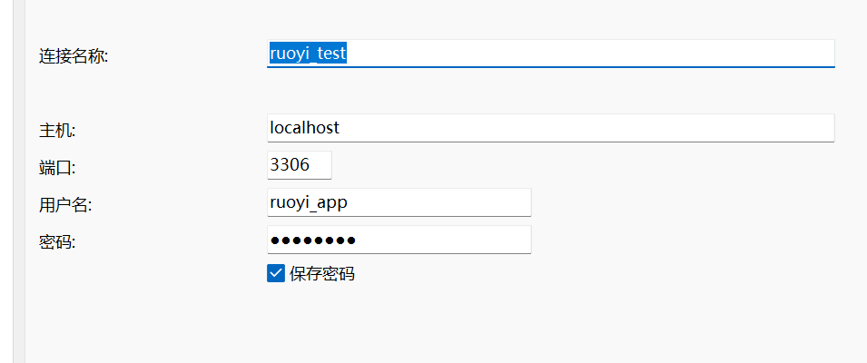

# 完成基础环境配置

```shell
# Java：版本与实际调用路径
java -version
javac -version
$env:JAVA_HOME
where.exe java

# Maven：版本、安装目录及使用的 Java
mvn -v
$env:MAVEN_HOME
where.exe mvn

# Node.js 与 npm
node -v
npm.cmd -v
where.exe node

# Git
git --version
where.exe git

# MySQL 客户端
mysql --version
where.exe mysql

# Redis 服务端与客户端（配置在linux中）
redis-server --version
redis-cli --version
where.exe redis-server
where.exe redis-cli
```

## 构建源码与依赖

后端 `pom.xml`：确认 Java、Maven 要求。

前端 `package.json` 和锁文件：确认当前 Node.js `24.16.0` 是否适配，以及使用哪个包管理器、安装命令。

### 前端构建

#### 源码安装

```powershell
npm.cmd install
npm.cmd audit //检查安装结果
```

#### 构建验证

```
npm.cmd run build:prod
$LASTEXITCODE
```

### 后端构建

```powershell
mvn -DskipTests package
```

### 配置Redius

在 **Xshell 的 Ubuntu 会话**中操作。我们让 Redis 监听本机和虚拟机地址，并设置密码，保留保护模式。[Redis 官方说明](https://redis.io/docs/latest/operate/oss_and_stack/management/security/)

**1. 备份配置文件**

```
sudo cp -p /etc/redis/redis.conf /etc/redis/redis.conf.bak-$(date +%Y%m%d-%H%M%S)
```

**2. 打开配置**

```
sudo nano /etc/redis/redis.conf
```

用 **Ctrl + W** 搜索下面各项，按回车定位，修改原有配置，避免重复添加：

| 配置项           | 设置                                          |
| ---------------- | --------------------------------------------- |
| `bind`           | `bind 127.0.0.1 192.168.192.10`               |
| `protected-mode` | 保持 `protected-mode yes`                     |
| `port`           | 保持 `port 6379`                              |
| `requirepass`    | 找到 `# requirepass foobared`，改为下面的格式 |

```
requirepass "REDACTED_LOCAL_PASSWORD"
```

去掉这一行开头的 `#`。设置独立密码，例如至少16位随机字母和数字；**不要原样使用占位文字，也不用把密码发给我。**

按 **Ctrl + O → 回车**保存，按 **Ctrl + X**退出。

**3. 重启并检查**

```
sudo systemctl restart redis-server
sudo systemctl status redis-server --no-pager
```

应显示 `active (running)`；如果失败，先把状态输出发给我，不继续后面的步骤。

**4. 验证密码和监听地址**

先不带密码连接：

```
redis-cli ping
```

现在应返回 `NOAUTH Authentication required`，说明需要认证。

再交互输入密码验证：

```
redis-cli -h 192.168.192.10 --askpass ping
```

输入刚设置的 **Redis 密码**，应返回 `PONG`。

**5. 在 Windows PowerShell 检查端口**

```
Test-NetConnection 192.168.192.10 -Port 6379
```

预期看到：

```
TcpTestSucceeded : True
```

把服务状态、`PONG` 和 Windows 端口结果发给我，截图避开密码。端口通过只证明网络可达，若依的实际认证和连接还要在后续启动时验证。

#### 读取实例版本

```
redis-cli -h 192.168.192.10 --askpass INFO server
```

### 配置数据库

登录

```mysql
mysql --default-character-set=utf8mb4 -h 127.0.0.1 -P 3306 -u root -p ruoyi_t2_lab
```

#### 创建数据库

```mysql
CREATE DATABASE ruoyi_t2_lab
  CHARACTER SET utf8mb4
  COLLATE utf8mb4_unicode_ci;

USE ruoyi_t2_lab;

SELECT DATABASE();

SHOW TABLES;
```

#### 导入表

设置连接集

```
SET NAMES utf8mb4;
```

导入两个表（Source）

```mysql
SOURCE E:/cpmputer_jobs/software_test_learning/Ruo_Yi/sources/backend/sql/ry_20260417.sql;

SOURCE E:/cpmputer_jobs/software_test_learning/Ruo_Yi/sources/backend/sql/quartz.sql;
```

#### 创建用户

检查用户是否存在

```mysql
SELECT User, Host FROM mysql.user WHERE User = 'ruoyi_app';
SELECT @@partial_revokes;
```

创建用户

```mysql
CREATE USER 'ruoyi_app'@'localhost'
IDENTIFIED BY '替换为你自己设置的数据库密码';
```

授予某个库的权限

```mysql
GRANT SELECT, INSERT, UPDATE, DELETE
ON `ruoyi\_t2\_lab`.*
TO 'ruoyi_app'@'localhost';
```

查看某个用户的权限

```mysql
SHOW GRANTS FOR 'ruoyi_app'@'localhost';
```

#### 用户登录

我们创建了这个项目的用户，我们以后就用这个登录

```mysql
mysql --default-character-set=utf8mb4 -h 127.0.0.1 -P 3306 -u ruoyi_app -p ruoyi_t2_lab
```

```
ruoyi_app
REDACTED_LOCAL_PASSWORD
```

#### navicat登录



## 启动前后端

### 启动后端

需要打开Redis

```java
Set-Location -LiteralPath 'E:\cpmputer_jobs\software_test_learning\Ruo_Yi\sources\backend'
java -jar .\ruoyi-admin\target\ruoyi-admin.jar '--spring.config.additional-location=file:./.local/application-local.yml'
```

### 启动前端

需要打开后端

```python
cd E:\cpmputer_jobs\software_test_learning\Ruo_Yi\sources\frontend
npm.cmd run dev -- --host 127.0.0.1
```

### 默认用户情况


## 冒烟测试

### 本阶段目的

通过少量核心操作，确认环境能支撑后续测试。这叫**冒烟测试**，不代表所有功能都已测试通过。

### 本次测试数据

| 对象         | 内容                              |
| ------------ | --------------------------------- |
| 部门         | `T24冒烟部门1009`，归属深圳总公司 |
| 角色         | `T24冒烟角色1009`                 |
| 角色权限字符 | `t24_smoke_1009`                  |
| 菜单权限     | 用户管理、用户查询                |
| 用户名       | `t24_user_1009`                   |
| 用户昵称     | `T24冒烟用户1009`                 |
| 用户编号     | `100`                             |
| 状态         | 正常                              |

**部门表示组织归属，角色决定权限，用户是实际登录的账号。**

### 操作流程与结果

| 步骤         | 操作                             | 验证结果                               |
| ------------ | -------------------------------- | -------------------------------------- |
| 管理员登录   | 进入系统管理 → 用户管理          | 用户列表正常加载                       |
| 创建部门     | 新增专用测试部门                 | 部门树中可找到                         |
| 创建角色     | 只勾选“用户查询”，保留父子联动   | 保存了列表、查询权限                   |
| 创建用户     | 分配专用部门和角色               | 创建成功                               |
| 保存后回查   | 搜索新用户，核对关联             | 编号100，部门、角色和状态正确          |
| 新用户登录   | 使用新账号进入系统               | 昵称与账号对应                         |
| 执行获准操作 | 进入用户管理，搜索自己           | 查询成功，未显示新增、修改、删除等按钮 |
| 重启复现     | 停止并重新启动前后端，再登录查询 | 同一用户仍可查询，数据保留             |
| 会话隔离     | 使用 Chrome 无痕窗口登录         | 独立会话中查询成功                     |

### 停止与重新启动

本轮保持 **MySQL、Redis 运行**，只重启前后端。

**停止：**前端终端按 `Ctrl+C`，再在后端终端按 `Ctrl+C`。

**启动后端：**

```
cd E:\cpmputer_jobs\software_test_learning\Ruo_Yi\sources\backend

java -jar .\ruoyi-admin\target\ruoyi-admin.jar '--spring.config.additional-location=file:./.local/application-local.yml'
```

**另开终端启动前端：**

```
cd E:\cpmputer_jobs\software_test_learning\Ruo_Yi\sources\frontend

npm.cmd run dev -- --host 127.0.0.1
```

访问 `http://127.0.0.1/`，重新登录并查询。**日常重启不需要重新建库、导入数据或创建账号。**
