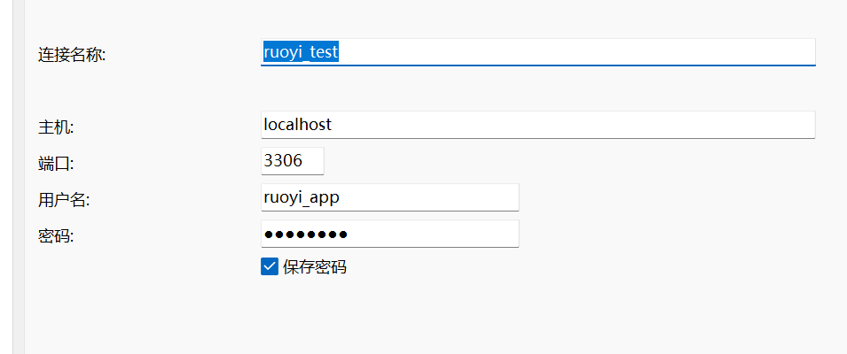

# 完成基础环境配置

```shell
# Java：版本与实际调用路径
java -version
javac -version
$env:JAVA_HOME
where.exe java

# Maven：版本、安装目录及使用的 Java
mvn -v
$env:MAVEN_HOME
where.exe mvn

# Node.js 与 npm
node -v
npm.cmd -v
where.exe node

# Git
git --version
where.exe git

# MySQL 客户端
mysql --version
where.exe mysql

# Redis 服务端与客户端（配置在linux中）
redis-server --version
redis-cli --version
where.exe redis-server
where.exe redis-cli
```

## 构建源码与依赖

后端 `pom.xml`：确认 Java、Maven 要求。

前端 `package.json` 和锁文件：确认当前 Node.js `24.16.0` 是否适配，以及使用哪个包管理器、安装命令。

### 前端构建

#### 源码安装

```powershell
npm.cmd install
npm.cmd audit //检查安装结果
```

#### 构建验证

```
npm.cmd run build:prod
$LASTEXITCODE
```

### 后端构建

```powershell
mvn -DskipTests package
```

### 配置Redius


在 **Xshell 的 Ubuntu 会话**中操作。我们让 Redis 监听本机和虚拟机地址，并设置密码，保留保护模式。[Redis 官方说明](https://redis.io/docs/latest/operate/oss_and_stack/management/security/)

**1. 备份配置文件**

```
sudo cp -p /etc/redis/redis.conf /etc/redis/redis.conf.bak-$(date +%Y%m%d-%H%M%S)
```

**2. 打开配置**

```
sudo nano /etc/redis/redis.conf
```

用 **Ctrl + W** 搜索下面各项，按回车定位，修改原有配置，避免重复添加：

| 配置项           | 设置                                          |
| ---------------- | --------------------------------------------- |
| `bind`           | `bind 127.0.0.1 192.168.192.10`               |
| `protected-mode` | 保持 `protected-mode yes`                     |
| `port`           | 保持 `port 6379`                              |
| `requirepass`    | 找到 `# requirepass foobared`，改为下面的格式 |

```
requirepass "REDACTED_LOCAL_PASSWORD"
```

去掉这一行开头的 `#`。设置独立密码，例如至少16位随机字母和数字；**不要原样使用占位文字，也不用把密码发给我。**

按 **Ctrl + O → 回车**保存，按 **Ctrl + X**退出。

**3. 重启并检查**

```
sudo systemctl restart redis-server
sudo systemctl status redis-server --no-pager
```

应显示 `active (running)`；如果失败，先把状态输出发给我，不继续后面的步骤。

**4. 验证密码和监听地址**

先不带密码连接：

```
redis-cli ping
```

现在应返回 `NOAUTH Authentication required`，说明需要认证。

再交互输入密码验证：

```
redis-cli -h 192.168.192.10 --askpass ping
```

输入刚设置的 **Redis 密码**，应返回 `PONG`。

**5. 在 Windows PowerShell 检查端口**

```
Test-NetConnection 192.168.192.10 -Port 6379
```

预期看到：

```
TcpTestSucceeded : True
```

把服务状态、`PONG` 和 Windows 端口结果发给我，截图避开密码。端口通过只证明网络可达，若依的实际认证和连接还要在后续启动时验证。

#### 读取实例版本

```
redis-cli -h 192.168.192.10 --askpass INFO server
```

#### 作用

Redis主要保存验证码、登录状态和登录失败次数等需要快速读取、能够自动过期的数据

### 配置数据库

登录

```mysql
mysql --default-character-set=utf8mb4 -h 127.0.0.1 -P 3306 -u root -p ruoyi_t2_lab
```

#### 创建数据库

```mysql
CREATE DATABASE ruoyi_t2_lab
  CHARACTER SET utf8mb4
  COLLATE utf8mb4_unicode_ci;

USE ruoyi_t2_lab;

SELECT DATABASE();

SHOW TABLES;
```

#### 导入表

设置连接集

```
SET NAMES utf8mb4;
```

导入两个表（Source）

```mysql
SOURCE E:/cpmputer_jobs/software_test_learning/Ruo_Yi/sources/backend/sql/ry_20260417.sql;

SOURCE E:/cpmputer_jobs/software_test_learning/Ruo_Yi/sources/backend/sql/quartz.sql;
```

#### 创建用户

检查用户是否存在

```mysql
SELECT User, Host FROM mysql.user WHERE User = 'ruoyi_app';
SELECT @@partial_revokes;
```

创建用户

```mysql
CREATE USER 'ruoyi_app'@'localhost'
IDENTIFIED BY '替换为你自己设置的数据库密码';
```

授予某个库的权限

```mysql
GRANT SELECT, INSERT, UPDATE, DELETE
ON `ruoyi\_t2\_lab`.*
TO 'ruoyi_app'@'localhost';
```

查看某个用户的权限

```mysql
SHOW GRANTS FOR 'ruoyi_app'@'localhost';
```

#### 用户登录

我们创建了这个项目的用户，我们以后就用这个登录

```mysql
mysql --default-character-set=utf8mb4 -h 127.0.0.1 -P 3306 -u ruoyi_app -p ruoyi_t2_lab
```

```
ruoyi_app
REDACTED_LOCAL_PASSWORD
```

#### navicat登录



## 启动前后端

### 启动后端

需要打开Redis

```java
Set-Location -LiteralPath 'E:\cpmputer_jobs\software_test_learning\Ruo_Yi\sources\backend'
java -jar .\ruoyi-admin\target\ruoyi-admin.jar '--spring.config.additional-location=file:./.local/application-local.yml'
```

### 启动前端

需要打开后端

```python
cd E:\cpmputer_jobs\software_test_learning\Ruo_Yi\sources\frontend
npm.cmd run dev -- --host 127.0.0.1
```

### 默认用户情况


## 冒烟测试

### 本阶段目的

通过少量核心操作，确认环境能支撑后续测试。这叫**冒烟测试**，不代表所有功能都已测试通过。

### 本次测试数据

| 对象         | 内容                              |
| ------------ | --------------------------------- |
| 部门         | `T24冒烟部门1009`，归属深圳总公司 |
| 角色         | `T24冒烟角色1009`                 |
| 角色权限字符 | `t24_smoke_1009`                  |
| 菜单权限     | 用户管理、用户查询                |
| 用户名       | `t24_user_1009`                   |
| 用户昵称     | `T24冒烟用户1009`                 |
| 用户编号     | `100`                             |
| 状态         | 正常                              |

**部门表示组织归属，角色决定权限，用户是实际登录的账号。**

### 操作流程与结果

| 步骤         | 操作                             | 验证结果                               |
| ------------ | -------------------------------- | -------------------------------------- |
| 管理员登录   | 进入系统管理 → 用户管理          | 用户列表正常加载                       |
| 创建部门     | 新增专用测试部门                 | 部门树中可找到                         |
| 创建角色     | 只勾选“用户查询”，保留父子联动   | 保存了列表、查询权限                   |
| 创建用户     | 分配专用部门和角色               | 创建成功                               |
| 保存后回查   | 搜索新用户，核对关联             | 编号100，部门、角色和状态正确          |
| 新用户登录   | 使用新账号进入系统               | 昵称与账号对应                         |
| 执行获准操作 | 进入用户管理，搜索自己           | 查询成功，未显示新增、修改、删除等按钮 |
| 重启复现     | 停止并重新启动前后端，再登录查询 | 同一用户仍可查询，数据保留             |
| 会话隔离     | 使用 Chrome 无痕窗口登录         | 独立会话中查询成功                     |

### 停止与重新启动

本轮保持 **MySQL、Redis 运行**，只重启前后端。

**停止：**前端终端按 `Ctrl+C`，再在后端终端按 `Ctrl+C`。

**启动后端：**

```
cd E:\cpmputer_jobs\software_test_learning\Ruo_Yi\sources\backend

java -jar .\ruoyi-admin\target\ruoyi-admin.jar '--spring.config.additional-location=file:./.local/application-local.yml'
```

**另开终端启动前端：**

```
cd E:\cpmputer_jobs\software_test_learning\Ruo_Yi\sources\frontend

npm.cmd run dev -- --host 127.0.0.1
```

访问 `http://127.0.0.1/`，重新登录并查询。**日常重启不需要重新建库、导入数据或创建账号。**

明白，你要的是 **“准备不同角色、部门及数据范围的测试账号并验证数据恢复方法”** 这一节。下面可直接复制到笔记。

## 测试账号配置与数据恢复

准备不同角色、不同部门的账号，验证操作权限和数据范围的基本效果，并通过账号重建验证测试数据能否恢复使用。

**核心概念**

| 概念         | 通俗理解                                 |
| ------------ | ---------------------------------------- |
| 用户         | 实际登录系统的账号                       |
| 部门         | 用户属于哪个组织                         |
| 角色         | 用户拥有哪些权限                         |
| 操作权限     | 可以做什么，例如查询、新增               |
| 数据权限     | 可以查看哪些记录，例如本部门用户         |
| 测试数据基线 | 已经核对正确、供后续对照和恢复的一组配置 |

**部门结构**

```
T25测试组织1009（201）
├─ T25部门A1009（202）
│  └─ T25部门A子组1009（203）
└─ T25部门B1009（204）
```

A部门、A子组、B部门用于构造同部门、上下级部门和跨部门对照。

**角色配置**

| 角色名称        | 编号 | 权限字符            | 操作权限                 | 数据范围               |
| --------------- | ---- | ------------------- | ------------------------ | ---------------------- |
| T25查询角色1009 | 101  | `t25_query_1009`    | 用户列表、查询           | 本部门                 |
| T25维护角色1009 | 102  | `t25_maintain_1009` | 用户列表、查询、新增     | 本部门                 |
| T25日志角色1009 | 103  | `t25_log_1009`      | 操作日志列表、查询与详情 | 本轮不验证日志部门隔离 |

维护角色只比查询角色多一项“用户新增”，便于观察单项权限差异。

**测试账号**

| 用途           | 用户名          | 当前编号 | 所属部门 | 角色     |
| -------------- | --------------- | -------- | -------- | -------- |
| 甲：查询对照   | `t25_a_query`   | 101      | A部门    | 查询角色 |
| 乙：新增对照   | `t25_a_add`     | 103      | A部门    | 维护角色 |
| 丙：跨部门对照 | `t25_b_query`   | 104      | B部门    | 查询角色 |
| 下级部门对照   | `t25_a_child`   | 105      | A子组    | 查询角色 |
| 重建练习对象   | `t25_a_created` | 108      | A部门    | 查询角色 |
| 日志查询       | `t25_log`       | 109      | 测试组织 | 日志角色 |

管理员 `admin` 用于配置组织、角色和账号；乙用户同时承担本轮有限查询、新增的管理用途。

**操作权限验证**

甲、乙都属于A部门，但角色不同：

- 甲可以查询用户，页面没有新增按钮。
- 乙可以查询用户，也能新增用户。
- 乙实际创建账号成功，操作日志能够对应。

结论：**同部门不代表拥有相同操作权限。**

按钮隐藏只证明页面表现，不能替代后续接口越权测试。

**数据范围验证**

| 测试场景              | 实际观察      |
| --------------------- | ------------- |
| A部门查询账号查看列表 | 显示A部门用户 |
| 丙用户查看列表        | 显示B部门用户 |
| 丙搜索甲账号          | 暂无数据      |
| 甲搜索子组账号        | 暂无数据      |
| 子组账号查看列表      | 显示子组用户  |
| 子组搜索甲账号        | 暂无数据      |

部分截图带有左侧部门筛选，因此这些结果用于基本对照，不能直接宣称所有数据权限边界均正确。

**为什么父部门看不到子部门用户？**

当前角色配置的是“本部门”，只包含用户所在部门。

| 数据范围     | 含义                       |
| ------------ | -------------------------- |
| 全部数据     | 该功能适用范围内的全部记录 |
| 自定数据     | 按配置选定的部门范围       |
| 本部门       | 用户所在部门               |
| 本部门及以下 | 所在部门及下级部门         |
| 仅本人       | 当前用户自身对应的数据     |

**父子部门关系不会自动授予查看权限。**本轮实际验证以“本部门”为主，其他范围尚未全面执行。

**新增账号没有权限的问题**

乙第一次创建 `t25_a_created`，编号106，未分配角色：

```
"roleIds": []
```

账号能够登录，但没有用户管理菜单。

管理员删除后，乙重新创建同名账号，编号107，分配查询角色：

```
"roleIds": [101]
```

之后账号可以进入用户管理。

结论：

- 创建账号和分配角色是两个配置动作。
- 新账号不会自动继承创建者的权限。
- 漏分配角色时，通常直接修改角色关联即可，不必删除重建。

**日志核验**

| 日志编号 | 时间     | 操作人员    | 操作内容                 |
| -------- | -------- | ----------- | ------------------------ |
| 120      | 16:31:07 | `t25_a_add` | 新增编号106，未分配角色  |
| 121      | 16:35:36 | `admin`     | 删除编号106              |
| 122      | 16:36:21 | `t25_a_add` | 新增编号107，分配角色101 |

使用专用日志账号 `t25_log`，按操作人员 `t25_a_add`、类型“新增”筛选，查到日志120、122。

打开日志122，核对：

```
操作人员：t25_a_add
请求：POST /system/user
目标用户编号：107
部门编号：202
角色编号：101
返回结果：code 200，操作成功
```

日志角色最初出现删除、清空、导出按钮。调整授权并重新登录后，这些按钮不再显示，查询及详情仍可使用。

**账号重建演练**

选择专用练习账号 `t25_a_created`，先保存配置和查询截图作为基线，再改变部门，最后按原配置重建。

| 对照项   | 原始基线     | 临时修改后 | 重建后       |
| -------- | ------------ | ---------- | ------------ |
| 用户编号 | 107          | 107        | 108          |
| 部门     | A部门        | B部门      | A部门        |
| 角色     | 查询角色     | 查询角色   | 查询角色     |
| 状态     | 正常         | 正常       | 正常         |
| 可见用户 | 甲、乙、自己 | 丙、自己   | 甲、乙、自己 |
| 数量     | 3条          | 2条        | 3条          |

操作过程：

1. 保存原始部门、角色、状态及查询结果。
2. 管理员把账号归属改为B部门。
3. 账号重新登录，确认可见数据变为B部门两条记录。
4. 管理员删除该练习账号。
5. 按原配方创建同名账号，分配A部门、查询角色、正常状态。
6. 记录新编号108，重新登录并核对详情。
7. 确认可见数据恢复为A部门三条记录。

结论：账号的配置和代表性使用效果恢复成功。编号、创建者及创建时间发生变化，需要更新测试数据记录。

本次采用**按配置重建账号**，没有执行全库备份还原。

# 开始测试

## 测试需求

| 核心需求           | 主要检查什么                                                 |
| ------------------ | ------------------------------------------------------------ |
| **用户创建与关联** | 合法资料能创建；重复账号等无效输入被拒绝；部门、角色保存正确 |
| **登录认证**       | 正常账号可以登录；错误凭据、停用账号等按规则被拒绝           |
| **操作权限**       | 有权限的人可以执行操作；没有权限的人不能通过直接请求绕过限制 |
| **部门数据范围**   | 用户只能看到授权范围内的数据，同时不会漏掉应该能看的记录     |
| **变更与禁用**     | 修改角色、部门或禁用账号后，分别检查新登录和旧会话的行为     |
| **日志追溯**       | 登录、创建、修改、禁用等动作能与相应日志关联，结果含义清楚   |

## 编写测试计划与记录表

 [T3逐例执行计划与记录模板.xlsx](..\functional_testing_period3\T3逐例执行计划与记录模板.xlsx)

## 执行测试计划
