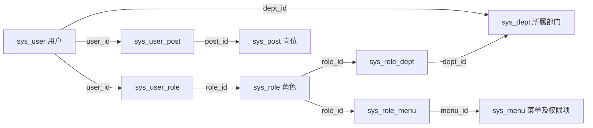

# T5.1 数据库表结构与业务关系核验

2026-10-19，项目负责人：x-k-forign。执行方式：自动化执行。

T5.1 已完成只读执行，并于 2026-10-19 按用户要求验收通过。数据库中共发现 31 张表，详细核对主线相关 9 张表、86 个字段。字段及主键与固定源码中的建表定义一致；这 9 张表均为 InnoDB，只有主键索引，没有外键约束和额外唯一索引。

真实用户查询验证了部门、角色、菜单及自定义数据范围的关联。所选样本没有发现引用对象缺失；该结果只覆盖本次列明的样本，不能据此判断全库无问题或实际权限行为全部正确。

## 成果入口

- [只读核验 SQL](../sql/T5.1_readonly.sql)：环境、元数据、真实对象及关联检查。
- [补充只读 SQL](../sql/T5.1_additional_readonly.sql)：多角色用户、数据库时区偏移及收尾回查。
- [字段字典与表清单](T5.1_字段字典.md)：9 张表的全部字段、默认值、可空性、主键及源码位置。
- [原始查询结果](../evidence/T51_20261019/read_only_results.json)：16 组 SELECT/SHOW 查询、9 条 SHOW CREATE TABLE 结果及结构对照。
- [补充查询结果](../evidence/T51_20261019/additional_results.json)：3 组 SELECT 查询。两份结果均保留实际 SQL、时间和返回内容。
- [交付核查](../evidence/T51_20261019/delivery_validation.json)：文件、证据、结构比较、样本收尾和脱敏检查。

## 环境与范围

| 项目 | 本次事实 |
|---|---|
| 执行窗口 | 主核验 18:25:43，补充核验 18:26:44，均为 Asia/Shanghai |
| 数据库 | 本机 127.0.0.1:3306，ruoyi_t2_lab，MySQL Community Server 8.4.11 |
| 连接身份 | 从现有后端 .local/application-local.yml 读取应用账号；CURRENT_USER 与 USER 均核对为该账号，交付中用别名脱敏 |
| 实际权限 | 仅该库 SELECT、INSERT、UPDATE、DELETE；无 CREATE、ALTER、DROP 等 DDL 权限。本次只使用读取能力 |
| 事务 | 连接 19；会话 autocommit=1、隔离级别 REPEATABLE-READ；显式 START TRANSACTION READ ONLY，读取结束后 ROLLBACK |
| 时区 | 会话 SYSTEM；系统时区名称返回乱码，保留原始值；补查 NOW 与 UTC_TIMESTAMP，当前偏移为 480 分钟，即 UTC+08:00 |
| 工具 | 实际采集使用既有 Python 3.13.12、PyMySQL 1.2.0；mysql 命令行客户端 8.4.11 可用 |
| 后端基线 | 13db1fcef36bee9ce45d2d636a1d4e8f5ed5bbc3，工作区干净 |
| 前端基线 | 838965c5a18d2c61b73ec30c6e288057aaa08b63，保留已有 vite.config.js 修改 |
| 数据操作 | 无 INSERT、UPDATE、DELETE、DDL、登录、故障注入或 Redis 键操作；未读取密码值、令牌或联系方式 |

范围为用户、部门、角色、菜单、岗位和四张中间表。其余 22 张表只列入表清单，未逐字段核验。本轮不把数据库账号权限与若依登录账号的业务权限混为一谈。

前后端在上一轮已启动，当前结构查询直接访问数据库；本轮没有重复启动、重新导入初始化脚本或重新构建服务。

## 实际表关系

以下箭头表示逻辑引用，**不表示数据库建立了外键**。



| 关系 | 业务含义 | 数据库实际保证 |
|---|---|---|
| sys_user.dept_id → sys_dept.dept_id | 用户自身所属部门；一个用户行存一个部门 ID，字段允许 NULL | 部门 ID 是部门表主键，但该引用没有外键 |
| sys_user_role.user_id、role_id | 用户和角色多对多，用户可拥有多个角色 | 复合主键禁止同一用户与同一角色重复成对出现；不能保证被引用用户、角色存在 |
| sys_role_menu.role_id、menu_id | 角色配置菜单及操作权限项 | 复合主键禁止重复关联，无外键 |
| sys_role_dept.role_id、dept_id | 角色自定义数据范围内的部门，不是用户所属部门 | 复合主键禁止重复关联，无外键 |
| sys_user_post.user_id、post_id | 用户与岗位关联 | 复合主键禁止重复关联，无外键 |
| sys_dept.parent_id、ancestors | 上级部门 ID、逗号分隔的祖先路径 | parent_id 没有外键；ancestors 是字符串，不是多个外键 |
| sys_menu.parent_id | 菜单树的父项 | 没有自引用外键；0 作为根节点约定不自动构成缺失引用 |

关联路径可在 [SysUserMapper.xml](../../sources/backend/ruoyi-system/src/main/resources/mapper/system/SysUserMapper.xml) 的 selectUserVo（第 50 行起）及 [SysMenuMapper.xml](../../sources/backend/ruoyi-system/src/main/resources/mapper/system/SysMenuMapper.xml) 的 selectMenuPermsByUserId（第 106 行起）核对。

## 结构对照结果

对照基线为 [ry_20260417.sql](../../sources/backend/sql/ry_20260417.sql)。仅读取其中 CREATE TABLE 定义，没有执行初始化语句。

9 张表的字段名称、顺序、归一化类型、可空性、默认值、自增属性、字段注释及主键列顺序均一致，未发现缺列或多列。实际索引与约束元数据确认：每张表只有一个主键索引，四张中间表使用复合主键；不存在外键或 CHECK 约束。

比较时区分以下情况：

- 源码中的 bigint(20)、int(4) 等整数显示宽度与运行库显示形式不同，按基础整数类型归一化，不能据此判断存储范围发生变化。
- 运行库字符集为 utf8mb4、排序规则为 utf8mb4_unicode_ci；源码这些建表语句未显式声明字符集，不把继承的运行值写成结构偏差。
- 当前自增计数反映历次数据准备，例如 sys_user 的 AUTO_INCREMENT=166；不要求它等于初始化起点，更不能用“恢复自增值”覆盖已有数据。

### 需要区分的规则

1. **账号名称非空不等于数据库保证唯一。** sys_user.user_name 为 varchar(30)、NOT NULL，但没有 UNIQUE 索引；NOT NULL 也不等于不能存空字符串。正常创建入口另有实体校验和账号查重。依据：[SysUserController.java](../../sources/backend/ruoyi-admin/src/main/java/com/ruoyi/web/controller/system/SysUserController.java) 第 125—145 行，[SysUserMapper.xml](../../sources/backend/ruoyi-system/src/main/resources/mapper/system/SysUserMapper.xml) 第 134—136 行。本次没有执行重复插入，不新增并发缺陷结论。
2. **status 与 del_flag 是不同维度。** 用户 status=0 表示正常，1 表示停用；del_flag=0 表示未删除，2 表示逻辑删除。字段默认值不代表数据库通过 CHECK 限定了可选值。
3. **role_key 与 perms 不是同一项。** role_key 是角色标识，具体操作权限字符串保存在 sys_menu.perms，经 sys_role_menu 关联到角色。
4. **data_scope 注释不是完整规则。** 实际字段注释和基线 SQL 只列 1—4，但 [Constants.java](../../sources/backend/ruoyi-common/src/main/java/com/ruoyi/common/constant/Constants.java) 第 182—202 行及 [DataScopeAspect.java](../../sources/backend/ruoyi-framework/src/main/java/com/ruoyi/framework/aspectj/DataScopeAspect.java) 明确还有 5。此处记为注释覆盖不完整的实现说明，不修改表或另报已证实业务缺陷。

| data_scope | 源码含义 |
|---|---|
| 1 | 全部数据权限 |
| 2 | 自定义数据权限，使用 sys_role_dept |
| 3 | 本部门 |
| 4 | 本部门及以下部门 |
| 5 | 仅本人 |

数据范围还受角色启停、当前操作对应的权限、操作者是否管理员和会话信息影响。数据库里看到一条关联，不能直接替代实际登录后的权限测试。实现依据：[SysPermissionService.java](../../sources/backend/ruoyi-framework/src/main/java/com/ruoyi/framework/web/service/SysPermissionService.java)、DataScopeAspect；既有 BUG-T3-003/004 继续保留。

## 真实业务对象核验

这些对象均为既有测试数据，本轮没有新建账号。预期沿用 T2/T3 基线及 [T4.4 正常链和清理记录](../../api_testing_period4/docs/T4.4_执行结果与查看说明.md)，没有先查结果再把结果当作业务预期。

| 检查 | 操作前依据与对象 | 本次实际动作和结果 | 判定与收尾 |
|---|---|---|---|
| 用户部门和查询角色 | 现有查询用户 101，预期部门 202、角色 101 | user_baseline、user_department、user_roles 查询：用户正常且未删除，部门 202 正常，角色 101 正常且 data_scope=3 | 与基线一致；后续连接回查所选字段和关联数量未变 |
| 角色菜单及操作权限 | 角色 101 是查询角色；102 为有限新增角色 | role_menus 查询：101 关联 1/100/1000，非空权限为 list/query；102 另有关联 1001，增加 add，没有 edit | 配置层符合既有分工；没有替这些身份重新登录，不能记为本轮操作授权实测通过 |
| 所属部门与自定义范围 | T3 多角色用户 131，部门 202，角色 105/106；106 自定义部门 204 | custom_scope、custom_scope_users 和补充 multi_role_user 查询：131 仍有 105（范围3）和 106（范围2）；106 的 sys_role_dept 为 204 | 与 T3.4 恢复记录一致；用户的部门没有变成 204。两角色返回两行，不是两个用户 |
| T4 历史清理对象 | T4.4 A/C 批用户 151、153，已完成逻辑删除和关联清理 | historical_cleanup 查询：两者 del_flag=2、status=0，角色与岗位关联各为 0；部门字段仍为 202 | 与历史清理一致；status=0 不能抵消删除标记，不把这些账号当作仍可登录 |
| 样本引用完整性 | 用户 101/134/151/153、角色 101/102/106 所涉及引用 | 五类 LEFT JOIN 缺失检查：用户部门、用户角色、角色菜单、角色范围部门、用户岗位，issue_count 全为 0 | 没有发现本次样本引用的对象缺失；所选用户没有岗位关联，该项为空集检查，不代表所有岗位关系都已覆盖 |

多角色样本来源：[T3.4 权限矩阵与恢复说明](../../functional_testing_period3/docs/T3.4_权限矩阵与抽检说明.md)。用户 134 也参与了前后基础字段回查，仍为部门 202、角色 102、正常且未删除。

### 查询示例

下面只查本轮已确认的基线用户，不读取密码等字段：

```sql
SELECT u.user_id, u.user_name, u.dept_id, d.dept_name,
       ur.role_id, r.role_name, r.data_scope
FROM sys_user u
LEFT JOIN sys_dept d ON u.dept_id = d.dept_id
LEFT JOIN sys_user_role ur ON u.user_id = ur.user_id
LEFT JOIN sys_role r ON ur.role_id = r.role_id
WHERE u.user_id = 101;
```

本轮相同关联路径的已执行查询见 user_department、user_roles。示例把两段查询合在一起方便阅读，不另计执行用例。对应数据是用户 101/t25_a_query → 部门 202/T25部门A1009 → 角色 101/T25查询角色1009 → 范围 3（本部门）。

用户 151/153 的数据库行仍在，但 [SysUserMapper.xml](../../sources/backend/ruoyi-system/src/main/resources/mapper/system/SysUserMapper.xml) 的 selectUserList 明确过滤 u.del_flag='0'。这解释了已删除行与正常列表可见性之间的区别；本轮没有请求列表接口，也不将按 ID 查询的其他入口一概视为采用相同过滤。

## 运行与恢复说明

使用已有 mysql 或 Navicat 连接本机 ruoyi_t2_lab，先确认连接目标，再执行两份只读 SQL。文件中的 CURRENT_USER、USER、SHOW GRANTS 在本机可能显示账号信息，对外分享时按本轮证据形式脱敏。SQL 中没有密码，口令只在本地输入。

mysql 客户端内可依次运行：

```sql
SOURCE E:/cpmputer_jobs/software_test_learning/Ruo_Yi/database_testing_period5/sql/T5.1_readonly.sql;
SOURCE E:/cpmputer_jobs/software_test_learning/Ruo_Yi/database_testing_period5/sql/T5.1_additional_readonly.sql;
```

每份脚本以只读事务开始、ROLLBACK 结束。ROLLBACK 在这里用于结束读取事务，不是撤销后端接口已经提交的业务数据。若途中报错，应确认连接仍在后手工结束事务；本轮两次事务均已结束、连接已关闭。

本轮未产生业务数据，无需清理账号、恢复配置或重建数据库。补充查询用新连接检查了用户 101/134/151/153 的基础字段及角色、岗位关联数量，与主核验一致；这不等于对全库做过前后快照。只新增了本阶段说明、SQL、脱敏证据和本地执行辅助文件。execution_build 保留在本地，不作为以后上传内容。

## 原理说明与需要确认的要点

**两张表都有 user_id，是否证明存在外键？** 不证明。列名只提供关联线索，要查建表语句和约束元数据。本轮四张中间表有复合主键，但没有外键；主键负责禁止重复组合，不能阻止引用不存在的对象。

**页面不显示用户，是否说明数据库没有那行？** 不一定。151/153 的历史行仍在，但已经逻辑删除；普通列表还受筛选和数据范围影响。要结合具体入口、操作者和实际字段判断，不能仅凭一张页面下结论。

**所属部门和数据范围为什么不能混为一谈？** 131 的所属部门是 202，角色 106 自定义范围却指向 204；另一个角色 105 是本部门范围。用户归属回答“用户在哪个部门”，角色范围回答“符合条件的操作可以访问哪些部门数据”。最终实际可见集合仍需后续接口验证。

**看到关联就能认定权限已生效吗？** 不能。旧会话是否采用最新配置必须独立验证，沿用既有撤权和调部门缺陷的结论边界。本轮只建立后续核验所需的结构与配置基准。

用户只需查看上述结果并确认是否理解这四点，无需重复全部机械查询。按当前协作约定，由自动化执行提供证据与解释，不把说明当作用户独立操作或业务实测证据。

## 执行状态与后续安排

T5.1 的环境、结构、关系、真实对象示例及原理说明已经验收，大纲仅更新本节四项勾选和约定的自测方式。T5.2—T5.6 尚未执行，T5.7 存储过程仍为选学。

TC-C08-01、TC-M07-02、TC-G04-03 本轮未执行，T3/T4 台账不改状态；BUG-T3-001—005 均未关闭。没有提交或推送 Git，也没有同步 GitHub 发布副本。

下一步是 T5.2：在同一业务基准上做条件查询、排序分页、聚合分组与页面/接口数据对照；故障注入和业务写入仍按后续隔离方案推进。

## T5.1 验收结论

验收日期：2026-10-19。用户已明确确认“这几个点我理解了”，并要求验收 T5.1。按此前约定，由自动化执行完成操作与证据整理，原理说明由用户查看确认；不把这次确认写成用户独立编写 SQL 或独立作答的证明。

| 本节原有标准 | 判定 | 依据 |
|---|---|---|
| 实际环境与元数据 | 通过 | 实际连接身份核验、MySQL 8.4.11、账号权限、9 张表的 SHOW CREATE TABLE 及 86 字段、索引和约束证据；不只引用历史资料 |
| 对象关系与约束 | 通过 | 关系图、字段字典与源码位置完整；实际无外键、无额外唯一索引，逻辑关联和应用查重均已区分 |
| 真实对象与状态 | 通过 | 用户 101/134/131 的实际部门、角色与范围记录；151/153 的逻辑删除及关联清理单列，口令和密码哈希未进入交付 |
| 原理说明与理解确认 | 通过（按约定方式） | 本记录四项原理说明及本次用户确认；对应外键、逻辑删除、所属部门与范围、配置与实际权限的区别 |

验收重新核对了保存的查询证据、SQL 与基线文件摘要、交付检查结果和链接，没有重跑业务链，也没有新增业务数据。此前交付核查中的“尚未验收”保留为执行收尾时的历史快照，当前状态以本节和 [验收核查记录](../evidence/T51_20261019/acceptance_validation.json) 为准。

结论：T5.1 通过，无本节必须补交项。该结论不表示整个 T5 完成、全库结构已审计、实际权限全部正确或既有缺陷已修复。T5.2 本次仅说明任务，尚未执行。
